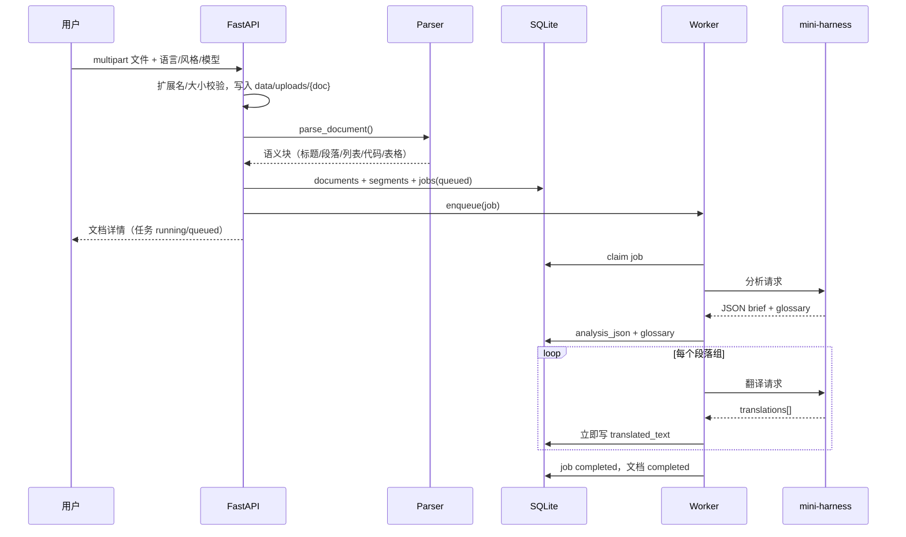

# Folio 译坊 — 设计说明

## 1. 目标与非目标

### 目标

1. **把整本书交给 AI**：不是逐句机翻，而是先理解全书，再在统一术语和风格下逐段翻译。
2. **对长任务友好**：上传后浏览器可以关闭；每段译文即时持久化；失败、重启、取消都可续译。
3. **多格式、多领域**：小说、学术书、数学书、法律/医学文档、技术手册都能进入同一套段落模型。
4. **公式可用**：扫描/公式书、DJVU 可由视觉模型逐页识别为 LaTeX，阅读器用 KaTeX 渲染。
5. **AI 承担主要工作**：OCR、分析、术语、翻译、审校都由模型完成；人只做选择、抽检和术语修正。
5. **复用 mini-harness**：平台不实现 agent loop、不保存模型 Key、不直接对接 provider。
6. **本地可运行**：单机 SQLite + 线程池 + 静态 SPA，无 Node 构建、无外部 CDN。

### 非目标

- 不是通用 CAT（计算机辅助翻译）工具，没有翻译记忆库、TMX、XLIFF 工作流。
- 不是 PDF 排版还原工具。平台保留语义结构，不还原原书版式、图片位置、脚注排版。
- 不是通用 OCR / 版面理解服务。视觉 OCR 只面向书籍正文与公式，不还原版式，不做手写识别。
- 不是强多租户 SaaS。没有组织、支付、邮箱验证、OAuth。
- 不做模型训练或微调。

---

## 2. 总体架构

```mermaid
flowchart LR
    B[Browser SPA] -->|Cookie session| F[FastAPI :8090]
    F --> DB[(SQLite WAL)]
    F --> FS[(data/uploads, data/exports)]
    F --> Q[TranslationService<br/>ThreadPool(2)]
    Q --> P[TranslationPipeline]
    P --> OCR[Vision OCR<br/>PDF → images → LaTeX]
    P --> H[mini-harness :8000]
    OCR --> H
    H --> M[DeepSeek / GLM / MiniMax]
    P --> DB
    P --> EX[Exporter]
    EX --> FS
```

### 为什么是这种形态

- **FastAPI + 原生 SPA**：平台的主要复杂度在解析与任务编排，不在前端框架。原生 JS 足以实现阅读器、轮询和术语编辑，部署只需 Python。
- **SQLite + WAL**：单机、零运维、事务可靠；段落级写入频率不高，前台轮询是只读。未来多实例时替换为 Postgres。
- **线程池而不是消息队列**：翻译是 I/O-bound（等待模型），线程池足够；任务状态在 SQLite 中，进程重启后可恢复。需要横向扩展时再引入 Redis/Celery。
- **单进程任务队列**：`TranslationService` 用 `claim_job` 原子更新 `queued → running`，重复提交不会重复执行。
- **mini-harness 作为模型网关**：平台只需要一个 Bearer Key；模型路由、重试、上下文压缩、token 记账、管理台都在 harness 内。

---

## 3. 关键流程

### 3.1 上传



### 3.2 任务状态

```text
queued → running → completed
                 ↘ failed
queued/running → cancelled →（可 retry）
```

`documents.status` 与 `jobs.status` 分离：

- `documents.status` 表示用户看到的结果状态（`ready / processing / completed / failed / paused`）。
- `jobs.status` 表示一次具体执行。重试会产生新 job，旧 job 保留，便于累计 token 和审计。
- 文档累计 token = 所有 job 的 `tokens_total` 之和；单个 job 的 token 用于显示本次执行成本。

### 3.3 断点续译

任务开始时：

```text
done_ids = { segment.id | translated_text 非空 }
pending = 所有 translatable 且不在 done_ids 的段落
groups   = group_segments(pending)
```

因此：

- 服务重启：`mark_interrupted_jobs()` 把 `running` 置为 `failed`，`queued` 自动重新入队；用户点“继续翻译”即可。
- 网络失败：失败的组会拆成单段重试；仍失败的段落标记 `failed`，其余段落继续。
- 用户取消：worker 在每个组边界检查 `jobs.status='cancelled'`，停止新请求；已完成段落保留。
- 重新翻译（fresh）：清空 `translated_text` 和段落状态，保留分析、术语和导出目录，重跑全书。

---

## 4. 文档解析

### 统一中间表示

```python
Block(text, kind, level, page, chapter, translatable)
```

`kind ∈ {heading, paragraph, list, quote, table, code}`。

统一表示的好处：

- 阅读器、导出器、翻译器只处理一种结构；
- 不同格式的差异被限制在 parser 内；
- 代码块可标记 `translatable=False`，读者仍能看到原文；
- 数学公式留在 `text` 中，由 prompt 约束模型不翻译符号。

### 各格式策略

| 格式 | 策略 | 重点 |
| --- | --- | --- |
| PDF | PyMuPDF 文本 block | 页眉页脚去除、标题字号/加粗判断、扫描件检测 |
| DOCX | `iter_inner_content()` | 保持段落与表格的原始顺序；识别 Heading 样式与列表 |
| EPUB | spine + BeautifulSoup | 按阅读顺序展开章节；过滤 nav/script/style |
| Markdown | 行级状态机 | 标题、列表、引用、表格、代码块；不丢块级结构 |
| TXT | 空行分段 + 章节正则 | 编码探测；无空行时降级为逐行分块 |
| HTML | BeautifulSoup | 语义标签提取；脚本/样式/导航移除 |
| DJVU | `ddjvu` → 图像 PDF → 视觉 OCR | 内置 DjVuLibre；扫描页不依赖文字层 |

### PDF 的难点

- **页眉页脚**：按页面首尾 block、数字归一化后统计重复；再用“页码出现在页边距”的启发式删除 running head。
- **标题识别**：字号大于正文中位数 ×1.18、加粗且短、或匹配 `Chapter/Part/第X章`。
- **扫描件**：如果平均每页可提取字符 <20，文本解析会抛出 `ParseError`；`auto` 模式随后探测页数并转入视觉 OCR。
- **DJVU**：上传时用内置 `ddjvu -format=pdf` 转为图像 PDF，再走视觉 OCR。DJVU 不会伪装成文本解析。
- **碎片化**：OCR 过的 PDF 可能把一段拆成多个 block；平台保留这些 block，由模型按上下文翻译，不强行合并，避免误伤公式和边注。

### 长段拆分

`split_long_text` 在 3800 字符附近按句末标点/空行切分；翻译分组再按 4200 字符、10 段、章节边界聚合。这样既控制单次请求大小，也不让一个超长段落撑爆上下文。

---

### 4.4 AI 视觉 OCR

文本层不是总能代表页面内容：数学书里的图注、分式、上下标、集合运算经常被 PDF
提取成 `G G ∪ - G ∩` 这样的碎片。视觉 OCR 把**页面当作图片**重新识别。

流程：

```text
PDF 页面 --(PyMuPDF, 180 DPI)--> JPEG --(base64 data URL)--> mini-harness Vision
       --> JSON blocks(type/level/text) --> ocr_pages 缓存 --> segments
```

关键设计：

- **按页而不是按全文调用**：单页图像清晰、输出可控、失败可重试；一本 400 页书就是
  400 次小请求，而不是一次不可控的巨型请求。
- **页级缓存**：`ocr_pages` 以 `(document_id, page_no)` 为主键。取消、崩溃、额度不足后
  重试只处理未完成页。
- **DJVU 转换**：内置 `vendor/djvulibre/bin/ddjvu` 把 DJVU 转成图像 PDF；369 页测试书约 5
  秒完成转换。转换后的 PDF 仍走同一套 OCR 缓存与页面渲染。
- **严格 JSON 块**：`heading / paragraph / list / quote / table / code / formula /
  caption / note`。模型不返回 Markdown 文档，避免平台再去猜结构。
- **LaTeX 约定**：行内 `$...$`，独立公式 `$$...$$`；公式块如果没有分隔符，平台自动补
  `$$`。图形内可读的公式标签允许转录，但不允许描述图形、编造关系。
- **页边注处理**：能明确归属的术语合并进正文括号；孤立的页码、页眉页脚忽略，避免阅读
  器出现大量碎片 note。
- **成本**：实测单页 4k–7k tokens（180 DPI，DeepSeek V4.1 Flash）。400 页扫描书约 2M
  OCR tokens，另加翻译 token。`VISION_OCR_MAX_PAGES` 默认 2000，足够 900+ 页的
  DJVU/扫描书。
- **质量控制**：OCR 完成后仍走同一套分析/术语/翻译/审校；公式块在翻译 prompt 中被明确
  标记为 LaTeX，禁止改写。

### 4.5 KaTeX 公式渲染

- 阅读器加载本地 `katex.min.js` + `auto-render.min.js`，对 `$...$`、`$$...$$`、
  `\(...\)`、`\[...\]` 做自动渲染。
- `formula` 块如果没有分隔符，前端会自动包 `$$`。
- 独立 HTML 导出把 KaTeX CSS、woff2 字体（base64）和 JS 内嵌，下载后离线也能渲染。
- Word 导出：`latex2mathml` + `mathml2omml` 把 LaTeX 转成 Word 原生公式（OMML）；
  转换失败的公式回退为 LaTeX 文本。EPUB / Markdown 保留 LaTeX 源码。
- 公式块与普通段落共享同一套双语对照：原文公式、译文公式并排显示。

### 4.6 原书插图裁切

OCR 只给出文字与公式，不能替代原图。平台直接从原始 PDF 页面裁切插图：

- 用图注文本（`Fig. 1.1.2` / `图 1.1.2`）在页面中定位 anchor；
- 收集 anchor 附近的矢量绘图（`page.get_drawings()`）与嵌入图片（`page.get_image_rects()`）；
- 按纵向间距聚成图组，选择离图注最近的一组；
- 把图组下方/上方的短标签（`G`、`G'`、`G ∪ G'`）并入裁切框；
- 裁切框在页面坐标系中限制，不包含图注正文；
- 以 200 DPI 渲染 PNG，保存到 `data/assets/{document_id}/`；
- 通过 `segments.asset_path` 挂到对应 caption 段落。

这样图形、节点、连线、手写式标注和集合公式都保持原书样子，不需要模型重新画图。HTML 导出把图片 base64 内嵌，Word 用 `add_picture`，EPUB 加入 resources，Markdown 复制到 `assets/`。

目前对**有矢量绘图或可搜索图注的 PDF**效果最好；纯扫描页如果没有图注坐标，还不会自动裁图。

### 4.7 PDF 生成

PDF 采用 **HTML → Chromium print-to-pdf**，而不是另写排版器：

1. 复用 HTML 导出的完整 KaTeX、图片 base64 和语义结构；
2. 在打印副本中注入 Fandol Song 字体（`file://` 本地字体），解决无系统中文字体时的方框问题；
3. 注入 `@page { size:A4; margin:16mm 14mm }`、避免标题/图片跨页截断；
4. Chromium 以 `--print-to-pdf` 输出，生成后缓存；
5. 全局限一个 PDF 任务，并在可用内存 <1.2 GB 时拒绝，避免 Chromium 拖垮服务。

完整书 PDF 可能较大（GTM173：540 页 / 18 MB / ~3m20s），所以只在用户点击下载时生成，
不阻塞翻译任务；再次下载直接命中缓存。

## 5. 提示词契约

所有 AI 阶段都要求**严格 JSON**，平台校验后再写库。这比“让模型输出 Markdown，再正则解析”稳定。

### 5.1 分析

输入：元数据 + 前 18,000 字符样本。
输出：语言、译名、文类、摘要、语气、目标读者、翻译策略、16–32 条术语。

### 5.2 翻译

输入：

- 文档 brief（标题、作者、文类、摘要、语气、策略、风格）；
- 当前章节；
- 前后各 600 字符上下文（仅参考，不翻译）；
- 最多 80 条术语；
- 1–10 个 `{id,type,text}` 段落。

输出：

```json
{"translations": [{"id": 42, "text": "……"}]}
```

约束：

- 每个 id 必须返回，不能合并/拆分段落；
- 不增删内容、不写译者注；
- 保留 Markdown、LaTeX、编号、换行；
- 原文没有的 `**`/`*`/反引号不得新增；
- 术语表精确使用。

### 5.3 审校

输入：原文 + 译文 + 术语表，6 段一批。
输出：只包含需要修改段落的 `revisions`。

审校不是“重译”，而是“只改确实有问题的地方”，避免模型反复改写正确译文。

### 5.4 后处理

- 原文没有 `**` 时删除译文中的 `**`；
- 原文没有反引号且译文只有一对反引号时删除；
- `strip()` 首尾空白；
- 不做自动术语替换：模型可能在语境中合理变化词形，机械替换反而破坏语法。

---

## 6. 并发、重试与错误模型

### 并发

- 每个 job 最多 6 个段落组并发（`TRANSLATION_CONCURRENCY`，默认 6）。
- 视觉 OCR 每批最多 4 页并发（`VISION_OCR_CONCURRENCY`，默认 4）。
- 全局 2 个 job 并发（`ThreadPoolExecutor(max_workers=2)`）。
- 每个任务最多约 10 个并发模型请求（6 翻译或 4 OCR），内存占用有界。
- 每批 `as_completed` 后才进入下一批，便于取消和进度更新。
- 页面图像只在当前 OCR 批次内存活，批次结束即释放；不会把整本书图片同时载入。

### 重试层次

```text
Level 1: HTTP 层（harness 内部 LLM_MAX_RETRIES）
Level 2: JSON 解析（run_json retries=2，追加修复指令）
Level 3: 组 → 单段（组输出缺 id/无法解析时逐段重试）
Level 4: 全部完成后，对仍缺失的段落再单独补一轮
Level 5: 仍失败 → 段落 failed，任务 completed + warning
```

只有以下情况会让整个 job 失败：

- harness 返回 401/402/5xx 等带 HTTP status 的错误；
- 网络/超时；
- 本地数据库/导出异常。

单段解析失败不会让整本书失败。

### 快速模式（关闭思考）

`deepseek-v4.1-flash` 默认带 reasoning，推理 token 计入 completion，明显拖慢翻译。
平台允许每个任务选择 `thinking=false`，此时连接到第二个 harness：

```text
主 harness :8000  LLM_THINKING=true   质量模式
fast harness :8001 LLM_THINKING=false  快速模式（共享 DB/Key）
```

- 两个 harness 共用用户、Key、用量账本；
- 平台启动任务时先用 `/healthz` 探测 fast harness，不可用则回退主实例；
- OCR、分析、翻译、审校都会使用选中的实例；
- 关闭思考不是“少输出”，而是不发送 `thinking: enabled`，模型直接生成答案。
- 当前 OpenCode Zen 的 `deepseek-v4.1-flash` 可能因额度不足返回 402；平台默认改为
  直连 `deepseek-flash`，仍保留 Zen 模型供额度恢复后选择。

### 用户追加提示词

`documents.custom_prompt` 保存用户要求（最多 4000 字）。流水线在：

- 分析请求：`owner_instructions`
- 翻译请求：`owner_instructions`
- 审校请求：`owner_instructions`

运行时每个翻译组都会重新读取 `custom_prompt`，因此任务运行中追加提示，下一批即可生效。
系统提示明确：用户指令不能覆盖“不编造、保留公式/LaTeX、严格 JSON”等硬约束。

### 零停机更新（blue/green）

运行中的长任务不能被重启打断，因此生产环境可以：

1. 新代码启动第二个 app 实例（例如 `:8091`）；
2. 设置 `APP_SKIP_RECOVERY=1`，避免新实例把旧实例的 `running` 任务标成 failed；
3. 使用独立静态目录 `APP_STATIC_DIR=app/static_v2`，避免新 UI 影响旧实例；
4. 两个实例共享 SQLite；旧实例继续跑旧任务，新实例接新任务；
5. 旧任务结束后停掉旧实例，把新实例切到 8090。

本次升级就是这样保护 `doc_511...` 的进行中 OCR 任务的。

### 额度

- 平台不直接向 provider 付费，不实现 token 计价。
- 每次 `client.run` 返回 `usage`，平台立即累加 `jobs.tokens_*`。
- 失败请求如果 harness 已记账但未返回 usage，平台无法获知；这是当前架构的已知边界。
- 如需严格平台额度，应使用每用户独立 harness Key，并读取 harness `/v1/usage`。

---

## 7. 阅读与导出

### 阅读器

- 服务端分页（默认 40 段），避免一次加载整本书。
- `q` 对原文/译文做 LIKE 搜索；`chapter` 精确过滤。
- 三种模式：对照、仅译文、仅原文；字号三档。
- 标题层级、列表、引用、代码、表格分别渲染；公式由 KaTeX 渲染。
- 未翻译段落显示“待翻译…”，让用户看到进度而不是空白。

### 导出

| 文件 | 内容 |
| --- | --- |
| `translated.docx` | 目标语言，标题层级、列表、引用、代码、术语表；公式为 Word OMML；插图嵌入 |
| `bilingual.docx` | 原文灰色斜体 + 译文（译文公式为 Word OMML）；插图嵌入 |
| `translated.md` | 目标语言 Markdown |
| `bilingual.md` | 原文引用块 + 译文 |
| `translated.txt` | 纯文本 |
| `book.html` | 独立网页，内置 CSS + KaTeX（含字体），双语，离线渲染公式；插图 base64 内嵌 |
| `book.pdf` | A4 PDF；Chromium 打印；Fandol 中文 + KaTeX + 插图；按需生成 |
| `translated.epub` | 目标语言 EPUB，按一级标题分章 |

导出在 job 完成时生成一次；下载时若文件缺失会按当前段落重新生成。

---

## 8. 数据与持久化

### 为什么段落是核心表

- 翻译的最小计费/重试单位是段落；
- 阅读器、搜索、导出都按段落顺序；
- 失败隔离、断点续译、进度统计都依赖 `segments.status`；
- 不需要把整本书序列化成一个巨大 JSON。

### 状态字段

| 字段 | 取值 |
| --- | --- |
| `segments.status` | `pending / done / failed / skipped` |
| `segments.translatable` | 代码块等为 0 |
| `jobs.stage` | `queued / extract / analysis / glossary / translation / review / export / completed / failed / cancelled` |

### 为什么不用一个 `progress` 浮点字段表示一切

`progress` 只用于 UI；真正的恢复依据是段落是否已有 `translated_text`。这样即使进度写失败，也不会重复翻译或漏译。

---

## 9. 安全设计

- 密码：PBKDF2-HMAC-SHA256，310,000 次，独立随机 salt。
- 会话：40 字节随机 token，数据库只存 SHA-256；Cookie `HttpOnly`、`SameSite=Lax`。
- 授权：所有文档相关查询都带 `user_id`，防止 IDOR。
- 上传：扩展名白名单、大小上限、文件名 `Path(...).name`、保存路径由服务端生成。
- 参考书目：只接受配置目录的直接子文件名；`resolve()` 后校验 parent，拒绝 `..`、绝对路径、符号链接逃逸。
- 导出：`_safe_filename` 清理下载名；HTML 对书籍文本统一 `html.escape`。
- 前端：所有动态文本通过 `esc()` 转义，避免书籍内容注入 HTML。

### 仍需在生产环境补的

- 反向代理 TLS、登录限流、CSRF token（SameSite 之外）。
- 每个用户独立 harness Key 或平台侧配额。
- 上传文件病毒扫描/内容嗅探。
- 审计日志和管理员角色。
- 备份 `data/folio.db` 与 `data/uploads`。

---

## 10. 可观测性

- 服务日志：job 开始、每批完成、失败堆栈。
- UI：阶段、进度、已译段落、token、当前模型、错误信息。
- 管理侧：mini-harness 自带 `/admin/ui`，可查看用户、额度、调用正文与实时运行。
- 当前没有 Prometheus 指标；若生产化，建议增加：
  - `folio_jobs_total{status}`
  - `folio_translation_segments_total{status}`
  - `folio_llm_tokens_total`
  - `folio_job_duration_seconds`

---

## 11. 扩展路径

### 水平扩展

```text
FastAPI × N  →  Postgres  →  Redis/Celery workers  →  S3/MinIO
                     ↘ 任务锁 / 心跳 / 重试队列
```

- 用 Postgres `SELECT ... FOR UPDATE SKIP LOCKED` 替代 SQLite `claim_job`。
- 把 `TranslationService` 替换为 Celery/RQ worker。
- 上传与导出放对象存储，数据库只存 key。
- 实时进度用 SSE/WebSocket 替代轮询。

### 质量增强

- 翻译记忆：相同 source hash 直接复用译文，跨文档共享。
- 章节级重译：只清理某章段落，减少重跑成本。
- 公式保真检查：原文/译文分别提取 LaTeX token，比较数量和顺序。
- 数字/专名检查：正则抽取数字、URL、引用编号，做译后校验。
- 自动质量评分：COMET / BLEU / 人工抽检；术语一致率、漏译率。
- OCR 增强：页级置信度、公式区域裁剪、低质量页提示与手动重跑。

### 产品增强

- 团队空间、评论、译者协作。
- 术语表 CSV/TBX 导入导出。
- 章节试译与报价预估。
- 多目标语言版本（同一原文，多译本）。
- 导出 PDF（需要排版引擎与 CJK 字体嵌入）。

---

## 12. 已知取舍

| 取舍 | 原因 | 代价 |
| --- | --- | --- |
| 单进程线程池 | 简单、零队列运维 | 不能跨机器扩展 |
| SQLite | 单机可靠、事务简单 | 多写者锁竞争 |
| 段落级翻译 | 可恢复、可并发、可搜索 | 跨段指代/长距离风格一致性依赖 brief 和上下文 |
| 不做 PDF 版式还原 | 复杂度高、收益低 | 导出是“重排”而不是“影印对照” |
| 视觉 OCR 按批并行 | 速度与内存平衡 | 单批失败会影响该批，页级缓存可重试 |
| DOCX 用 OMML 公式 | Word 中原生可编辑 | 复杂 LaTeX 转换失败时回退为文本 |
| 插图按页面几何裁切 | 保留原图，无需生成模型 | 纯扫描页缺少图注坐标时无法自动裁切 |
| 单 harness Key | 部署简单 | 平台用户额度不能直接映射到 harness 用户 |
| 推理模型默认 | 翻译质量更好 | token 成本高、速度慢 |

---

## 13. 验证记录

- 单元/接口测试：**19 passed**。
- 真实端到端：
  - 来源：`GTM173 Graph Theory` 第 1 章 4 页（参考书目目录）
  - 原文：8,146 字符，61 段
  - 模型：`deepseek-v4.1-flash`
  - 结果：33 条术语、61/61 段译文、7 种导出文件
  - 首轮 token：约 151k；断点补译：约 8k
  - 发现并修复：单个段落 JSON 解析失败导致 60/61；新增“完成后缺失段再补一轮”逻辑后恢复为 61/61。
- DJVU：内置 `ddjvu` 将 369 页 `GTM026` 转为图像 PDF；1 页样张上传后自动转换、OCR 出 3 段并完成翻译。
- 并行/快速模式：2 页 OCR 在 4 并发下约 35 秒完成；3 段翻译在 fast harness 下 2.7 秒完成；提示词在 3 次 AI 调用中均以 `owner_instructions` 注入。
- 整本任务：`GTM173 Graph Theory` 422 页、4,778 段，294 页 OCR 缓存断点续跑；4 页 OCR 并发、6 组翻译并发；最终 4,778/4,778 段、124 张插图、7 种导出，累计约 719 万 tokens。
- 402 后切换到直连 `deepseek-flash`，无需重跑 OCR；最后一次断点续传只消耗 15.5k tokens。
- 公式页 OCR：
  - 单页 PDF，180 DPI，`deepseek-v4.1-flash`
  - OCR 结果包含 `$$G \qquad G' \qquad G \cup G' \qquad G - G' \qquad G \cap G'$$`
  - 9 段译文全部保留 LaTeX；阅读器 KaTeX 渲染 100+ 个公式节点
  - 独立 HTML 导出离线渲染成功
- 插图裁切：
  - 同一页裁出 Fig. 1.1.2 原图，包含全部节点、连线、`G/G'/G∪G'/G−G'/G∩G'` 标签
  - 4 页章节共裁出 Fig. 1.1.1–1.1.4 四张图
  - Word、HTML、Markdown、EPUB 导出均带图

---

## 14. 结论

Folio 的核心不是“调用一次翻译 API”，而是把**长文档翻译当成一个可恢复、可观测、可人工修正的流水线**：

- 解析层把异构文档归一为段落；
- AI 层先理解再翻译，并用术语表约束一致性；
- 任务层把每次模型调用变成可计量、可重试、可续跑的工作单元；
- 产品层提供双语阅读、术语编辑和多格式交付。

它适合个人研究者、小型出版社、内部知识库和需要批量翻译技术文档的团队；在单机规模内，依赖最少、路径最短。
