# Folio 译坊

> 把一本原版书交给 AI：先读懂，再统一术语，逐段翻译，最后交付可阅读、可导出的双语版本。

Folio 译坊是一个**书籍与长文档 AI 翻译平台**。用户上传 PDF、DOCX、EPUB、Markdown、TXT 或 HTML，平台解析章节与段落，调用 [mini-harness](https://github.com/DreamIAYN/miniharness)完成全书分析、术语抽取、逐段翻译和可选二审，最终生成 Word、EPUB、Markdown、HTML 与纯文本版本。

对数学书和扫描书，平台支持 **AI 视觉 OCR**：逐页把 PDF 渲染成图片，由多模态模型识别文字与公式，输出带 **LaTeX** 的结构化文本；阅读器用 KaTeX 渲染行内公式和独立公式。

平台自身不持有模型 Key，也不实现 agent 循环：所有模型调用都通过 mini-harness 的 HTTP API 完成，翻译 token 由 harness 计量，页面可以随时关闭，任务在后台继续。


---

## 目录

- [核心能力](#核心能力)
- [界面](#界面)
- [快速启动](#快速启动)
- [使用流程](#使用流程)
- [翻译流水线](#翻译流水线)
- [支持格式](#支持格式)
- [架构](#架构)
- [数据模型](#数据模型)
- [API](#api)
- [质量策略](#质量策略)
- [成本与模型选择](#成本与模型选择)
- [安全与边界](#安全与边界)
- [测试](#测试)
- [目录结构](#目录结构)
- [路线图](#路线图)

---

## 核心能力

| 能力 | 说明 |
| --- | --- |
| 多格式导入 | PDF、DOCX、EPUB、Markdown、TXT、HTML；DJVU 自动转 PDF |
| AI 视觉 OCR | 扫描 PDF / DJVU / 公式密集 PDF 逐页渲染，多模态模型转写为结构化块；页级缓存可续跑 |
| LaTeX 公式 | OCR 与翻译保留 `$...$` / `$$...$$`；KaTeX 阅读渲染；HTML 内嵌 KaTeX；Word 转为原生公式（OMML） |
| 原书插图 | 从 PDF 原页按图注和矢量/图片区域裁切真实插图，附在对应图注旁；阅读、Word、HTML、EPUB 都会带上 |
| AI 全书分析 | 先识别语言、文类、语气、读者、翻译策略，再开始翻译 |
| 术语表 | AI 自动抽取 16–32 个专名/学科术语，支持人工增删改，翻译时强制使用 |
| 逐段翻译 | 按章节和长度分组，默认 6 路并发；每段完成即入库 |
| 并行 OCR | 视觉 OCR 默认 4 页并发，批次间可取消；内存有界 |
| 关闭思考 | 任务可选 fast harness（8001，`LLM_THINKING=false`），翻译/OCR 更快 |
| 追加提示词 | 上传时或任务运行中追加要求，注入分析、翻译、审校 prompt |
| 可选二审 | 独立 reviewer prompt 对比原文与译文，修正漏译、术语不一致和格式破坏 |
| 断点续译 | 任务失败、服务重启或用户取消后，已完成段落不重复计费 |
| 双语阅读 | 对照 / 仅译文 / 仅原文，章节跳转、全文搜索、字号调节 |
| 多格式导出 | Word 译本、Word 双语对照、PDF、Markdown、双语 Markdown、HTML、EPUB、TXT |
| 参考书目 | 直接导入服务器本地书目目录中的书，无需浏览器再次上传 |
| 多用户 | Cookie 会话、PBKDF2 密码哈希、按用户隔离书架 |
| 用量可见 | 单任务 token、文档累计 token、用户总 token |
| 数学书友好 | 视觉 OCR 识别图形中的公式标签；提示词固定保留 LaTeX、公式符号、编号、变量名与定理结构 |

## 界面

| 我的书架 | 导入新书 |
| --- | --- |
| 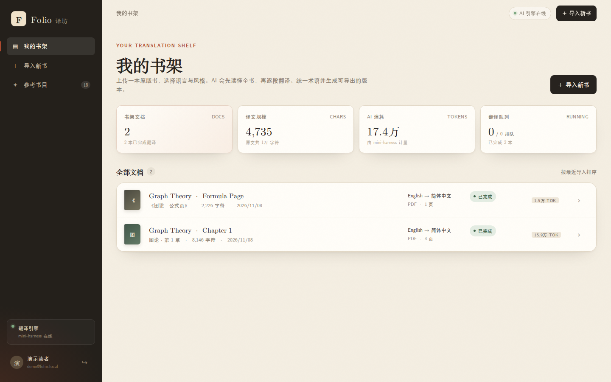 | 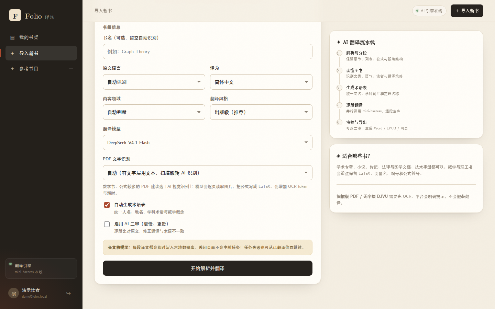 |

| 双语阅读 | 术语表 |
| --- | --- |
| 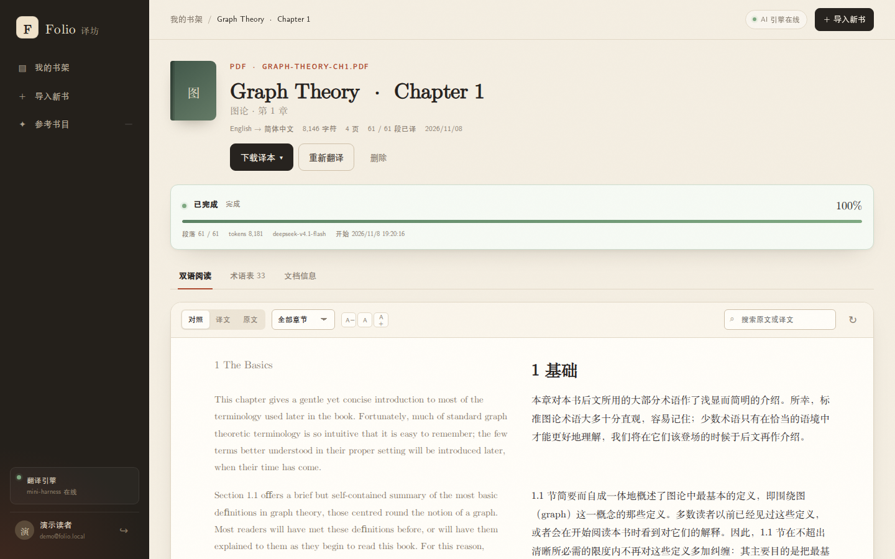 | 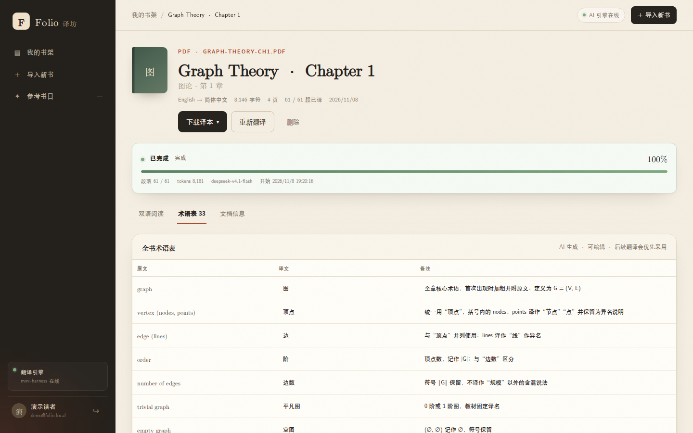 |

| AI 视觉 OCR + LaTeX 公式 | 原书插图裁切 |
| --- | --- |
| 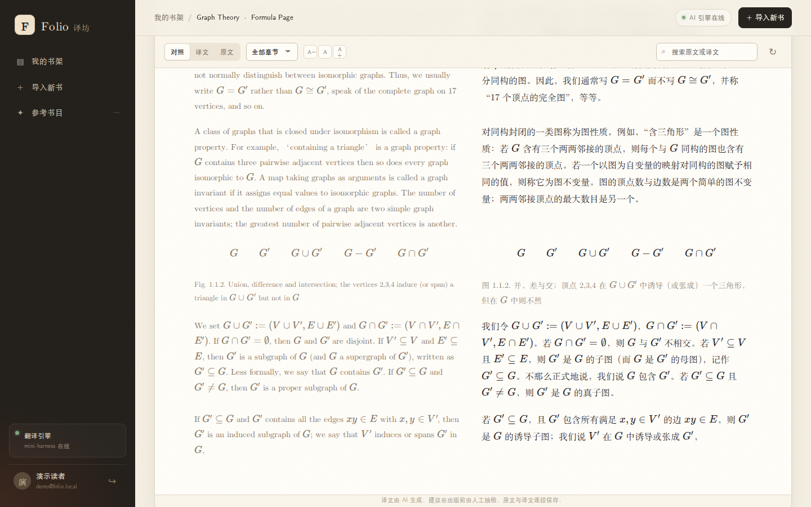 | 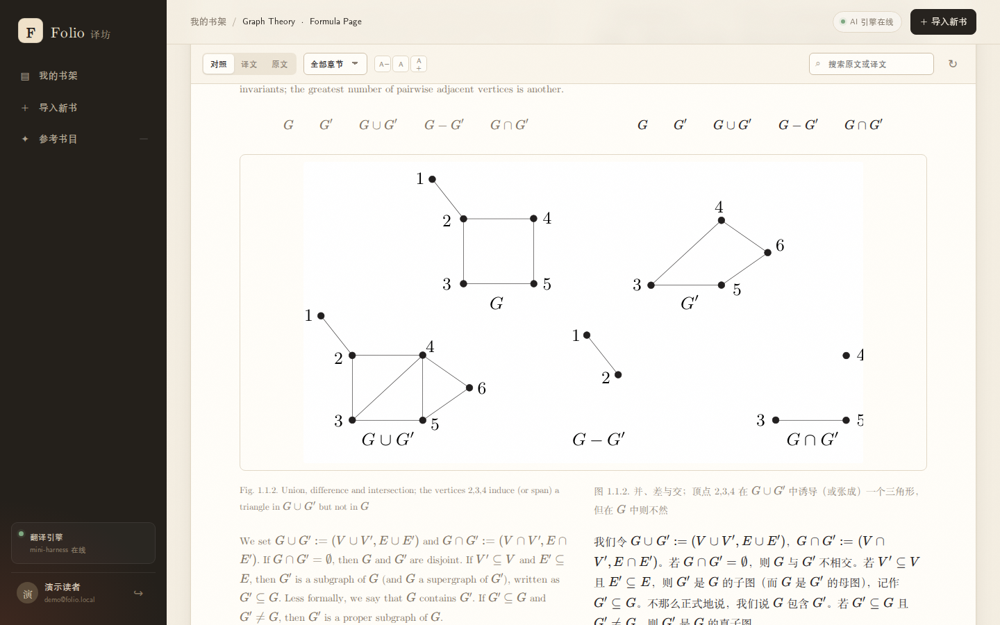 |

| AI 阅读笔记 | 参考书目 |
| --- | --- |
| 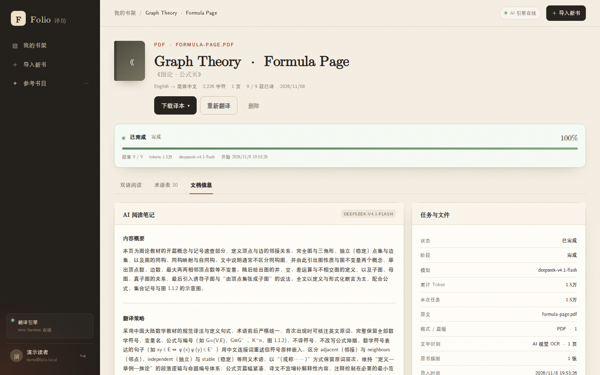 |  |

| 追加 AI 提示 + 关闭思考 | 快速模式运行中 |
| --- | --- |
| 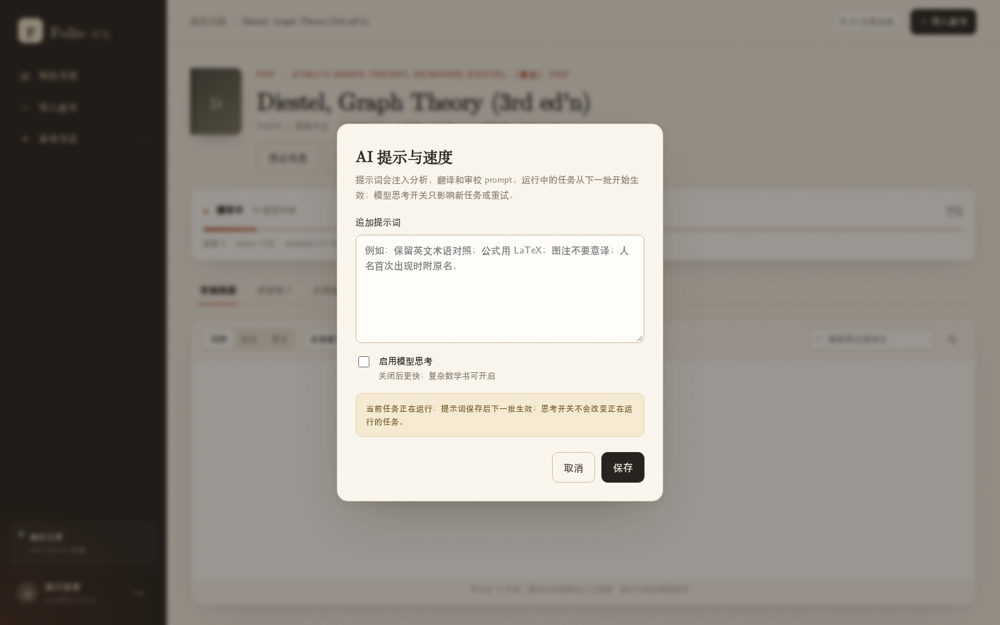 | 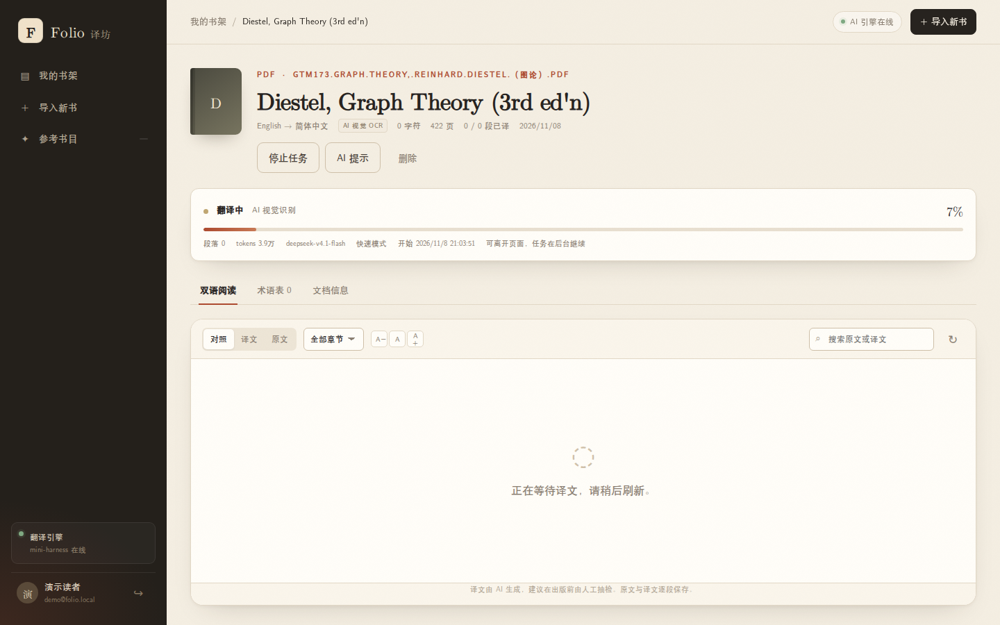 |

| PDF 公式与插图 | 完成的书架 |
| --- | --- |
| 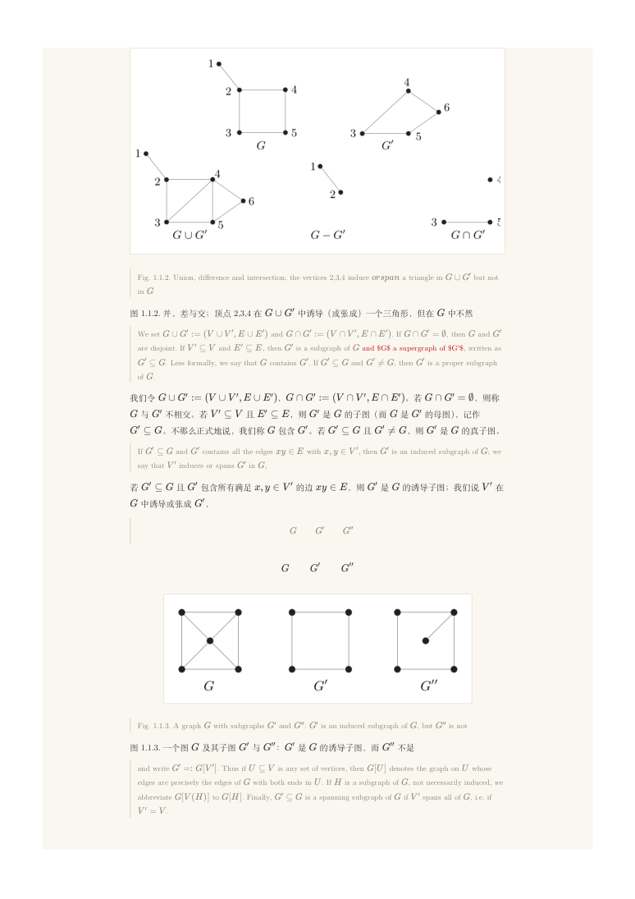 | 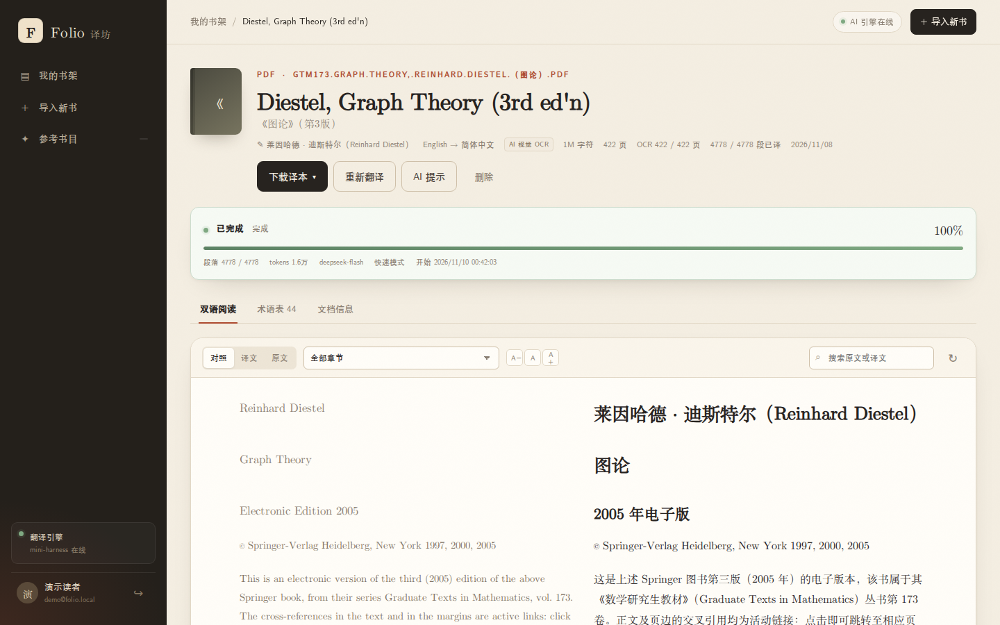 |

---

## 快速启动

### 0. 前置条件

- Python 3.11+
- 一个可用的 mini-harness 实例（默认 `http://127.0.0.1:8000`）
- mini-harness 已配置任一 OpenAI-compatible 模型后端

### 1. 启动 mini-harness

如果 miniharness 还没有运行：

```bash
cd ../miniharness
cp .env.example .env        # 首次
# 编辑 .env：填入 LLM_API_KEY 或 OPENCODE_ZEN_API_KEY
.venv/bin/python -m harness
```

健康检查：

```bash
curl http://127.0.0.1:8000/healthz
```

### 1.1 启动无思考 fast harness（可选，推荐）

平台可以把“快速模式”任务发到第二个 harness；它使用同一模型与 Key，但
`LLM_THINKING=false`，会跳过推理过程：

```bash
cd ../folio-translator
scripts/start_fast_harness.sh          # 监听 :8001
```

`.env`：

```bash
HARNESS_FAST_URL=http://127.0.0.1:8001
TRANSLATION_CONCURRENCY=6              # 同一任务内并行翻译组数
VISION_OCR_CONCURRENCY=4               # 并行 OCR 页数
```

如果 `HARNESS_FAST_URL` 不可用，任务会自动回退到主 harness 并继续。

> **402 说明**：OpenCode Zen 的 `deepseek-v4.1-flash` 额度耗尽时，harness 会返回
> `LLM provider returned HTTP 402`。本机默认已切换到直连 `deepseek-flash`；如仍选
> OpenCode Zen 模型，请先补充额度，否则改用 `deepseek-flash`。

### 2. 为平台创建专用 harness 用户

平台使用一个专用 Key 调用 mini-harness，便于统一计量和吊销。

```bash
ADMIN=$(grep '^HARNESS_ADMIN_TOKEN=' ../miniharness/.env | cut -d= -f2-)

curl -s -X POST http://127.0.0.1:8000/admin/users \
  -H "X-Admin-Token: $ADMIN" \
  -H "Content-Type: application/json" \
  -d '{
    "email": "booktrans@local",
    "name": "Book Translator",
    "quota_tokens": -1,
    "issue_key": true,
    "key_name": "folio-platform"
  }'
```

响应中的 `api_key`（`hx_...`）只出现一次，填入下一步的 `HARNESS_API_KEY`。

> 生产环境建议把平台用户与 harness 用户一一对应，或至少为平台单独设额度。

### 3. 启动 Folio

```bash
cd ../folio-translator

python3 -m venv .venv
.venv/bin/pip install -e ".[dev]"

cp .env.example .env
# 编辑 .env，至少填入 HARNESS_API_KEY

.venv/bin/python -m app
```

打开：<http://127.0.0.1:8090>

演示账户：

```text
邮箱：demo@folio.local
密码：folio2026
```

> 第一次启动会自动创建演示账户。公开部署前请修改 `DEMO_PASSWORD`，或删除演示账户。

### 4. 一键运行（当前环境）

本仓库所在机器上服务已经可以这样启动：

```bash
cd /path/to/folio-translator
.venv/bin/python -m uvicorn app.main:app --host 127.0.0.1 --port 8090
```

---

## 使用流程

1. **导入**：上传文件，或从「参考书目」直接导入。选择原文语言、目标语言、领域、风格、模型、PDF 文字识别方式；可追加提示词，并决定是否启用模型思考。
2. **解析 / OCR**：有文字层时直接解析；扫描版或选择「AI 视觉识别」时，逐页渲染并让多模态模型输出结构化块与 LaTeX 公式。
3. **分析**：AI 生成全书摘要、文类、语气、目标读者、翻译策略和初始术语表。
4. **翻译**：按章节/长度分组，每段即时写入 SQLite，页面可关闭。
5. **审校（可选）**：独立 AI reviewer 对比原文与译文，只返回需要修改的段落。
6. **阅读/导出**：在双语阅读器中阅读，编辑术语，下载 Word、EPUB、Markdown、HTML、TXT。

---

## 翻译流水线

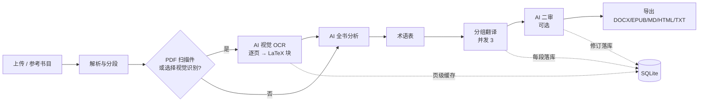

每次模型调用的提示词都要求**只输出 JSON**，平台做结构校验；解析失败会重试，仍失败则把该组拆成单段重试，避免一个坏段拖垮整章。

### 视觉 OCR 阶段（可选）

当 PDF 是扫描件、公式被文本层打散，或用户显式选择「AI 视觉识别」时：

1. PyMuPDF 以 180 DPI 逐页渲染为 JPEG；
2. 图片通过 mini-harness `images` 参数送给支持 Vision 的模型；
3. 模型输出 `{blocks:[{type,level,text}]}`，公式统一写成 `$...$` / `$$...$$`；
4. 每页结果写入 `ocr_pages`，任务中断后只重跑失败页；
5. 全部页完成后组装为段落；图注段落自动关联从原 PDF 裁下的矢量/图片区域；
6. 进入分析/翻译，阅读器和导出保留原图。

模型被要求：不要翻译、不要描述图形、不要编造关系；把图形中可读的公式标签转录为 LaTeX。页级 OCR 通常每页消耗约 4k–7k tokens。

插图不交给模型“画”出来，而是用 PyMuPDF 根据图注位置、矢量绘图和嵌入图片的几何区域，从原 PDF 页面直接裁切，所以线条、节点、标注和公式都保持原样。裁切图存放在 `data/assets/{document_id}/`，与图注段落关联；Word、HTML、Markdown、EPUB 导出都会包含。

相关配置：

```bash
VISION_OCR_MODEL=deepseek-v4.1-flash   # 必须支持图片输入
VISION_OCR_DPI=180                     # 公式书可提高到 200–220
VISION_OCR_MAX_PAGES=2000
VISION_OCR_MAX_TOKENS=24000
DJVU_BIN=vendor/djvulibre/bin/ddjvu
```

### 分析阶段

输出：

```json
{
  "detected_language": "en",
  "title_translation": "图论·第 1 章",
  "genre": "数学教材",
  "summary": "……",
  "tone": "严谨、清晰",
  "target_reader": "数学专业本科生",
  "translation_strategy": "……",
  "glossary": [
    {"source": "graph", "target": "图", "note": "数学对象", "confidence": 0.95}
  ]
}
```

### 翻译阶段

每个请求包含：书籍 brief、当前章节、前后各 600 字符上下文、最多 80 条术语、以及 1–10 个带 `id` 的段落。

输出：

```json
{"translations": [{"id": 42, "text": "……"}]}
```

### 审校阶段

可选。reviewer 只返回确实需要修改的段落：

```json
{"revisions": [{"id": 42, "text": "……"}]}
```

---

## 支持格式

| 格式 | 解析方式 | 说明 |
| --- | --- | --- |
| PDF（文本层） | PyMuPDF `dict` 模式 | 保留页、标题层级、段落；自动去除重复页眉页脚 |
| PDF（视觉 OCR） | PyMuPDF 渲染 + mini-harness Vision | 扫描件/公式页逐页识别，公式写为 LaTeX；页级缓存 |
| DOCX | python-docx | 标题样式、列表、表格按原顺序提取 |
| EPUB | ebooklib + BeautifulSoup | 按 spine 顺序读取章节 |
| Markdown | 自研块解析 | 保留标题、列表、引用、表格；代码块不翻译 |
| TXT | 编码探测 + 章节正则 | 支持 UTF-8 / GB18030 / Big5 / Latin-1 |
| HTML | BeautifulSoup | 标题、段落、列表、引用、代码、表格 |
| DJVU | 内置 DjVuLibre `ddjvu` → PDF → AI 视觉 OCR | 无需手动转 PDF；扫描页逐页识别文字与公式 |

> 上传时可选 `auto / text / vision`。`auto` 在检测到文字层缺失时自动切换到视觉 OCR；数学书、公式密集的书建议直接选 `vision`。DJVU 没有可靠文字层，平台会强制走「转 PDF → AI 视觉 OCR」。视觉 OCR 会增加 token 成本和耗时，模型识别也可能有误差，建议出版前抽检。

---

## 架构

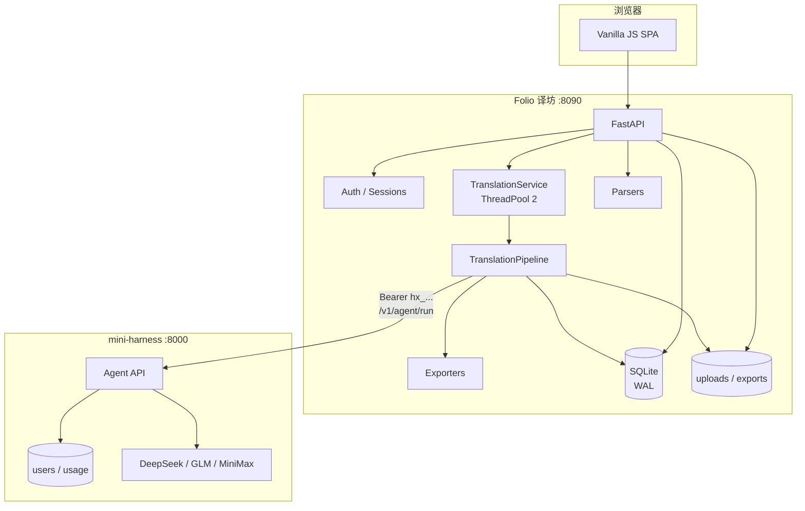

### 职责边界

| 组件 | 负责 | 不负责 |
| --- | --- | --- |
| `app/main.py` | 路由、鉴权、上传、下载、SPA | 模型调用 |
| `app/auth.py` | 密码、会话 Cookie | 权限矩阵 |
| `app/parser.py` | 多格式解析、分块、结构识别 | 翻译 |
| `app/vision_ocr.py` | PDF 逐页渲染、Vision OCR、LaTeX 块解析、页级缓存 | 翻译 |
| `app/pipeline.py` | 分析、术语、翻译、审校、断点 | 文件格式 |
| `app/harness.py` | mini-harness HTTP 契约、JSON 校验 | agent 循环 |
| `app/exporter.py` | DOCX/EPUB/Markdown/HTML/TXT | 阅读器分页 |
| `app/service.py` | 后台线程池、任务领取 | 业务提示词 |
| `app/db.py` | 用户、文档、任务、段落、术语 | 并发调度 |

更完整的设计取舍见 [DESIGN.md](DESIGN.md)。

---

## 数据模型

```sql
users(id, email, name, password_hash, role, created_at)
sessions(token_hash, user_id, created_at, expires_at)

documents(
  id, user_id, title, author, source_lang, target_lang, domain, style,
  filename, ext, size_bytes, page_count, char_count, word_count,
  segment_count, status, analysis_json, metadata_json, error,
  created_at, updated_at
)

jobs(
  id, document_id, user_id, status, stage, progress,
  total_segments, translated_segments, reviewed_segments,
  model, review_enabled, glossary_enabled,
  tokens_prompt, tokens_completion, tokens_total, error,
  created_at, started_at, finished_at
)

segments(
  id, document_id, idx, chapter, block_type, level, page,
  source_text, translated_text, status, tokens, translatable, error,
  asset_path, asset_width, asset_height
)

glossary(
  id, document_id, source_term, target_term, note, confidence
)
```

设计要点：

- **段落是翻译与阅读的最小单位**，所有格式最终都归一到 `segments`。
- **段落即时落库**，任务失败/重启后按 `translated_text` 跳过已完成部分。
- **每次任务独立记录 token**，文档累计 token 是各次任务之和。
- **术语表有唯一约束** `(document_id, source_term)`，重复抽取会更新而不是重复插入。
- **SQLite WAL** 让前台轮询不被翻译写事务阻塞。单机足够；多实例部署需换 Postgres + 对象存储。

---

## API

所有 `/api/*` 默认需要登录 Cookie，`/api/auth/*` 除外。

| 方法 | 路径 | 说明 |
| --- | --- | --- |
| GET | `/api/health` | 平台与 mini-harness 健康状态 |
| GET | `/api/models` | 从 harness 读取可用模型 |
| POST | `/api/auth/register` | 注册并登录 |
| POST | `/api/auth/login` | 登录 |
| POST | `/api/auth/logout` | 退出 |
| GET | `/api/auth/me` | 当前用户 |
| GET | `/api/stats` | 用户统计与队列 |
| GET | `/api/documents` | 文档列表 |
| POST | `/api/documents` | 上传并创建任务（multipart） |
| GET | `/api/documents/{id}` | 详情、任务、术语、章节、导出 |
| GET | `/api/documents/{id}/segments` | 阅读器分页 / 搜索 / 章节 |
| GET | `/api/documents/{id}/job` | 任务进度轮询 |
| POST | `/api/documents/{id}/cancel` | 取消 |
| POST | `/api/documents/{id}/retry` | `resume` / `fresh` 重试；可带 `thinking` / `review` |
| PATCH | `/api/documents/{id}/prompt` | 追加/更新 AI 提示词，运行中下一批生效 |
| DELETE | `/api/documents/{id}` | 删除文档及文件 |
| GET | `/api/documents/{id}/download?fmt=` | 下载导出；`fmt=pdf` 按需生成 PDF |
| GET | `/api/documents/{id}/assets/{name}` | 读取裁切插图（鉴权） |
| GET | `/api/documents/{id}/glossary` | 术语表 |
| POST | `/api/documents/{id}/glossary` | 新增术语 |
| PATCH | `/api/documents/{id}/glossary/{term_id}` | 修改译文/备注 |
| DELETE | `/api/documents/{id}/glossary/{term_id}` | 删除术语 |
| GET | `/api/library` | 参考书目列表 |
| POST | `/api/library/import` | 从参考书目导入并开始翻译 |

`POST /api/documents` 字段：

| 字段 | 说明 |
| --- | --- |
| `file` | 必填，文件 |
| `title` | 可选，留空自动识别 |
| `source_lang` | 默认 `auto` |
| `target_lang` | 默认 `zh-CN` |
| `domain` | `auto / math / science / cs / medicine / law / history / philosophy / literature / business / social / general` |
| `style` | `publish / academic / literary / faithful / concise` |
| `model` | harness 模型 alias |
| `review` | 是否启用 AI 二审 |
| `glossary` | 是否启用术语表 |
| `thinking` | 是否启用模型思考；默认 `false`，走 fast harness |
| `custom_prompt` | 追加给 AI 的要求，最多 4000 字 |
| `ocr_mode` | `auto` / `text` / `vision`；仅对 PDF 生效，`vision` 强制 AI 视觉识别 |

---

## 质量策略

1. **先分析后翻译**：整本书的 brief 会进入每个翻译请求，避免“逐段盲译”导致语气和术语漂移。
2. **术语强约束**：prompt 要求“use the glossary exactly”，并在二审中再次检查。
3. **保留结构**：翻译 prompt 明确禁止合并/拆分段落、增删注释、翻译代码、破坏 LaTeX/编号。
4. **模型加粗清理**：如果原文没有 `**`，译文中的 `**` 会被移除，避免模型擅自强调。
5. **失败隔离**：组解析失败则拆成单段重试；仍失败的段落会被标记，任务继续导出其余内容，并给出警告。
6. **公式保真**：OCR 阶段要求所有数学写为 LaTeX；翻译阶段禁止改写公式；阅读器用 KaTeX 渲染，HTML 导出内嵌 KaTeX。
7. **可人工介入**：术语表可编辑，读者可切换原文/译文对照检查。
8. **二审可选**：质量优先时开启；日常阅读可关闭以节省约 40% 时间与 token。
9. **追加提示**：用户可在上传时或任务运行中追加要求，注入分析/翻译/审校；提示词不能覆盖“不编造、保留公式、遵守 JSON”等硬约束。
10. **思考可关**：默认快速模式；需要复杂数学推理时可打开思考。

---

## 断点续传

三处断点都在 SQLite 中：

1. **OCR 页级**：`ocr_pages(document_id, page_no, blocks_json, status)`；失败/402/取消后只重跑未完成页。
2. **翻译段级**：`segments.translated_text` 非空即跳过；重试不会重复计费。
3. **任务状态**：`jobs.status` 与 `documents.status` 分离；失败或暂停的文档可点“继续翻译”从断点恢复。

续传时使用 `POST /api/documents/{id}/retry`，`mode=resume`（保留译文和 OCR 缓存）；
`mode=fresh` 才会清空译文重新开始。402 换模型后直接点“继续翻译”即可，不需要重跑 OCR。

## 速度与并发

默认并发：

| 阶段 | 并发 | 说明 |
| --- | ---: | --- |
| OCR 页 | 4 | 每批 4 页，批间检查取消；每页图像处理完即释放 |
| 翻译组 | 6 | 每组最多 10 段 / 4200 字符 |
| 全局任务 | 2 | 多本文档可同时跑 |

内存控制：

- OCR 只保留当前批次的页面 JPEG 与响应，不把整本书图片同时载入内存；
- 翻译组大小有上限，长段落会被拆分；
- 每个任务最多约 10 个并发模型请求（4 OCR 或 6 翻译），不会无限开线程；
- 任务状态、页级 OCR 缓存都在 SQLite，进程崩溃不会丢已完成页。

“关闭思考”任务会走 `HARNESS_FAST_URL`（8001）的 fast harness；不勾选时走主 harness（8000）。
当前模型 `deepseek-v4.1-flash` 的思考 token 也计入 completion，关闭后通常显著加快。

## PDF 下载

PDF 使用 **Chromium 打印** 生成，而不是重新排版：

- 先由 HTML 导出（KaTeX、图片已内联）生成打印页面；
- 注入 Fandol Song 中文字体，避免中文变成方框；
- 输出 A4、带页边距、公式/图片不跨页截断；
- 生成后缓存为 `book.pdf`，再次下载是秒级；
- PDF 仅在用户点击下载时生成，不影响翻译任务。

`GTM173` 完整 422 页原书最终 PDF：**540 页 / 18 MB**，生成耗时约 3 分 20 秒。
PDF 生成有全局单任务锁；可用内存低于 1.2 GB 时会拒绝生成，避免拖垮系统。

相关截图：[PDF 公式页](docs/screenshots/pdf-formula.png)。

## 成本与模型选择

- 平台不直接计价，token 由 mini-harness 记录。
- 推理模型会把 reasoning token 计入 `completion_tokens`，实际成本明显高于普通模型。
- 本仓库的参考验证：**8,146 字符的图论章节**，使用 `deepseek-v4.1-flash`，首轮约 **151k tokens**（含分析、术语、翻译）；断点补译只消耗约 **8k tokens**。
- 公式页视觉 OCR 实测：单页约 **4k–7k tokens**；400 页数学书 OCR 约 **2M tokens**，之后还要加上翻译 token。正式翻译前建议先试 3–5 页。
- 一本 300–400 页的数学书约 40–50 万字符；按同样模型估算，全书可能需要 **数百万到千万级 token**。正式翻译前建议：
  - 先用 5–10 页样章试译，确认风格；
  - 长书可先关闭二审，完成初译后再按章节抽检；
  - 对成本敏感时选 `deepseek-flash` 直连或 `glm-5.3-flash`，并在样章上比较质量；
  - 平台按 4200 字符分组并发，已尽量避免无谓的上下文重复。

---

## 安全与边界

### 已实现

- PBKDF2-SHA256（310,000 次）密码哈希；会话 token 只存 SHA-256 摘要。
- HttpOnly + SameSite=Lax Cookie。
- 所有文档、任务、段落、术语查询都带 `user_id` 过滤。
- 上传扩展名白名单、100 MB 上限、文件名净化。
- 参考书目只允许导入配置目录的**直接子文件**，拒绝路径穿越。
- 导出文件名净化；HTML 导出对书籍内容做转义。

### 边界

- `local` 版是单机、单进程服务，不是强多租户 SaaS。
- 没有邮箱验证、找回密码、OAuth、支付和团队空间。
- 视觉 OCR 依赖多模态模型；公式识别仍可能出错，尤其是低分辨率扫描、复杂图表和手写内容。
- DJVU 由内置 DjVuLibre 的 `ddjvu` 转为图像 PDF；369 页的测试书转换约 5 秒，但随后的 OCR 仍需按页耗时。
- OCR 逐页串行执行，一本 400 页扫描书可能需要较长时间；页级缓存避免重跑已完成页。
- 插画裁切目前依赖 PDF 的矢量绘图/嵌入图片或可搜索图注；纯扫描页若没有图注坐标，暂不会自动裁图。
- DJVU 转换依赖随仓库提供的 `vendor/djvulibre`；如果换机器，可设置 `DJVU_BIN` 指向系统 `ddjvu`。
- 平台使用单一 harness Key；如需 per-user 额度，应为每个平台用户签发独立 harness Key。
- SQLite 适合单机；多 worker 共享同一 SQLite 可能产生锁竞争。

---

## 测试

```bash
cd folio-translator
.venv/bin/pytest -q
```

覆盖：

- 密码哈希/校验
- TXT / Markdown / DOCX / EPUB / PDF 解析
- PDF 视觉 OCR 块归一化、LaTeX 包裹、OCR 页缓存
- PDF 插图区域裁切与图注关联
- 长段拆分、章节分组
- 术语与段落数据库读写
- 7 种导出文件生成；HTML 导出内嵌 KaTeX
- 注册/登录/未授权访问
- 文档详情、分页、搜索
- 不支持格式拒绝

当前：**19 passed**。

真实端到端验证：

- 从参考书目 `GTM173 Graph Theory` 截取第 1 章 4 页：8,146 字符、61 段、33 条术语、7 种导出，并修正了一个失败段落。
- 公式页验证：单页 PDF 经 AI 视觉 OCR 识别出 `$$G \qquad G' \qquad G \cup G' \qquad G - G' \qquad G \cap G'$$` 等 LaTeX，9 段译文全部保留公式；阅读器、独立 HTML 导出和 Word 导出均验证通过。
- DJVU 验证：参考书目中的 `GTM026` 用内置 `ddjvu` 转为 369 页 PDF；另生成 1 页 DJVU 样张，上传后自动转换、OCR 出 3 段并完成翻译。
- **整本验证（2026-11-10）**：`GTM173 Graph Theory` 422 页，4,778 段、102 万原文字符；从 294 页 OCR 缓存断点续跑，4 页并行 OCR、6 组并行翻译，最终 4,778/4,778 段完成，生成 124 张原书插图和 7 种导出（DOCX/EPUB/HTML/Markdown/TXT）。累计约 719 万 tokens（含此前失败尝试）。
- 402 验证：OpenCode Zen 返回 402 后切换到直连 `deepseek-flash`，任务无需重跑 OCR，只补 128 页并继续翻译；最后一次续传仅消耗 15.5k tokens。
- 插图验证：从同一页裁出 Fig. 1.1.2 的原图（图、节点、标签、集合运算符号完整），挂在图注上方；4 页章节共裁出 4 张图（Fig. 1.1.1–1.1.4）。

---

## 目录结构

```text
proj20/
├── app/
│   ├── main.py          # FastAPI 路由 / SPA 服务
│   ├── auth.py          # 密码与会话
│   ├── config.py        # 环境配置
│   ├── db.py            # SQLite schema 与 DAO
│   ├── parser.py        # PDF/DOCX/EPUB/MD/TXT/HTML/DJVU 解析
│   ├── vision_ocr.py    # PDF 逐页视觉 OCR + LaTeX 块
│   ├── figures.py       # 从原 PDF 页面裁切插图并关联图注
│   ├── pipeline.py      # 分析 → 术语 → 翻译 → 审校
│   ├── prompts.py       # 三类提示词与输出契约
│   ├── harness.py       # mini-harness HTTP 客户端
│   ├── exporter.py      # DOCX/EPUB/MD/HTML/TXT
│   ├── library.py       # 本地参考书目
│   ├── service.py       # 后台任务线程池
│   ├── cli.py           # folio 入口
│   └── static/          # 无构建 SPA + Fandol 中文字体 + KaTeX
├── tests/
├── scripts/start_fast_harness.sh
├── docs/screenshots/
├── vendor/djvulibre/    # 内置 ddjvu / libdjvulibre（DJVU 转换）
├── data/                # SQLite、上传、导出、样例（gitignored）
├── .env.example
├── DESIGN.md
├── README.md
└── pyproject.toml
```

---

## 路线图

- OCR 增强：页级置信度、手动重跑单页、公式区域裁剪以降低成本。
- 章节级重译：只重跑某一章，不影响其他章节。
- 翻译记忆：跨文档复用相同原文的译文，进一步降低 token。
- 术语表导入/导出（CSV/ TBX）。
- 译后质量报告：漏译率、术语一致率、数字/公式保真检查。
- 多用户 harness Key 映射与平台侧额度。
- Postgres + 对象存储 + 任务队列，支持多实例横向扩展。

---

## License / 说明

本项目为本地部署示例。参考书目中的书籍版权归各自权利人所有；平台只处理用户有权翻译的内容。AI 译文建议在出版或正式使用前由人工审校。
